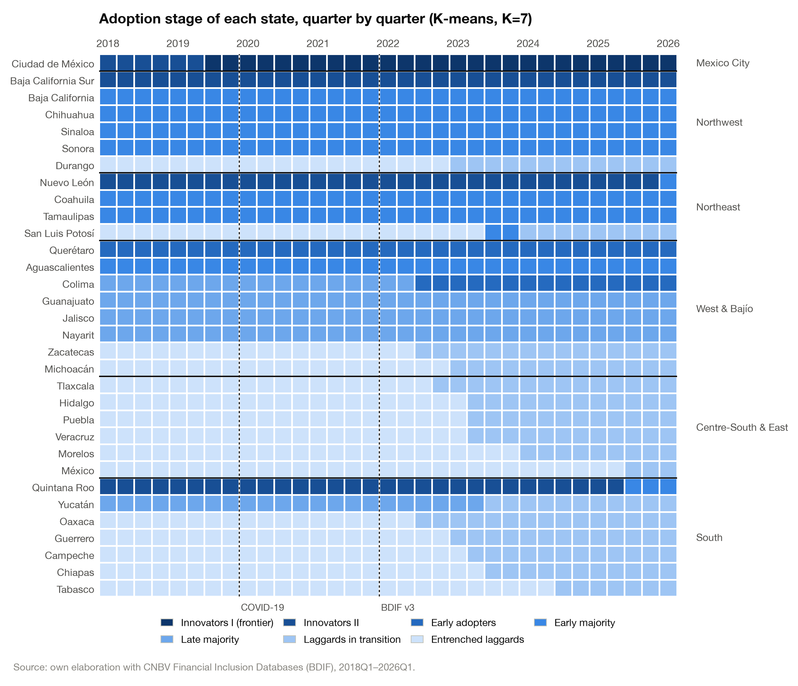
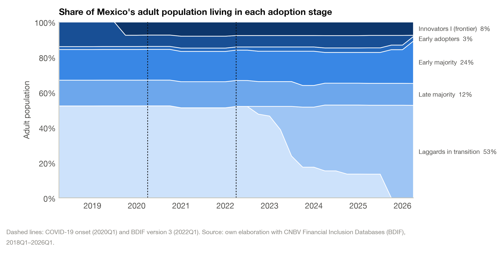

# Digital Financial Access in Mexico: Territorial Trajectories, 2018–2026

Code, data and outputs for the chapter **"Changing Stage, Not Tier: Territorial Trajectories of Digital Financial Access in Mexico, 2018–2026"**, prepared for the Springer volume *Territorial Inequalities and Impact Evaluation* (proposed for the series *Advances in Spatial Science*).

The analysis extends the master's thesis *Efectos de la digitalización en los hábitos financieros de la población mexicana* (Verónica Guzmán Ayala, Instituto Politécnico Nacional, Escuela Superior de Economía, 2026).

## Research question

Did Mexico's left-behind states converge toward the digital-finance frontier, or did they only change position within the lagging tier?

## Data

`versiones_unidas_definitivas.csv` is a quarterly state-level panel built from the CNBV [Bases de Datos de Inclusión Financiera](https://www.gob.mx/cnbv/acciones-y-programas/bases-de-datos-de-inclusion-financiera): 32 states × 33 quarters (2018Q1–2026Q1), 1,056 observations. It contains nine access-infrastructure indicators per 10,000 adults (`*_x10K`) together with their raw counts.

| Code | Indicator |
| --- | --- |
| SBC | Commercial bank branches |
| SBD | Development bank branches |
| SSoc | Socap branches (savings and loan cooperatives) |
| SSof | Sofipo branches (popular financial companies) |
| Corr | Banking agents |
| CA | ATMs |
| TPV | POS terminals |
| ETPV | Merchants with POS |
| CBM | Contracts using mobile banking |

## Methods

- **K-means typology** (K = 7, k-means++). K is chosen with the elbow, silhouette, Davies–Bouldin and bootstrap-ARI criteria. Clusters are ordered by a Digital Access Index and mapped to Rogers' adopter categories.
- **DBSCAN** on the first three principal components, used as a density-based robustness check.
- **Population-weighted Theil index**, decomposed into between-region and within-region components.
- **Quarter-to-quarter transition matrices** for the pre-COVID, COVID and post-COVID periods.
- **Relative-position re-estimation** on within-quarter z-scores, which separates absolute upgrading from catch-up.
- **Sensitivity analyses**: alternative K, a log transformation and a DBSCAN parameter grid.
- **Exploratory event study** of the Banco del Bienestar branch expansion. It uses two-way fixed effects with state-clustered standard errors and tests for pre-trends.

## Reproduce

```bash
pip install -r requirements.txt
python3 analisis/analisis_clusters.py
```

The run takes about 20 seconds. It writes:

- `analisis/figuras/*.png`: 11 figures at 300 dpi, plus vector versions in `analisis/figuras/pdf/`. A 600-dpi TIFF version is also produced but not versioned.
- `analisis/tablas/*.csv`: 22 result tables (`t00`–`t22`), covering descriptives, Theil, model selection, centroids, assignments, transitions, DBSCAN, the event study and sensitivity analyses.

`analisis/preparar_envio.py` builds the publisher package from a Word export of the manuscript, which is not included here. It converts the LaTeX equations to native Word equations, gives the tables APA formatting and writes figure files plus an alt-text sheet. It needs Microsoft Word's `mathml2omml.xsl`.

## Main results

- Mobile-banking contracts per 10,000 adults rose almost sevenfold (1,813 → 12,482). Development-bank branches rose nearly fivefold, and commercial branches fell 20%.
- Every state that began as an *entrenched laggard* became a *laggard in transition* after 2022. Even so, the laggard tier still holds **53% of Mexico's adults**, and on relative positions 14 of 15 initial laggards remain in the bottom two groups.
- Mobile-banking inequality doubled (Theil 0.10 → 0.22), but only because of Mexico City. Among the other 31 states it fell from 0.044 to 0.015.
- DBSCAN finds a continuous central-southern core, a distinct northern border belt and a metropolitan-tourist frontier, with Mexico City as an outlier.





## Status

The chapter is under review. The manuscript is not distributed here. Please cite the chapter once it is published.
